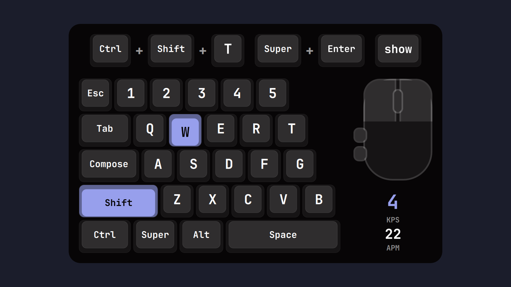

# Keycast

An on-screen keycaster for the Omarchy shell with two layouts:

- **Stream**: the all-purpose layout for screencasts and tutorials. Recent keys
  appear as keycaps. Plain typing merges into one word cap, shortcuts show one
  cap per key joined by `+` (`Super + Ctrl + T`), repeats count up (`×3`), and
  mouse clicks and scrolling can show too. Entries fade out after a set time.
- **Gamer**: a fixed board that lights every held key, with three presets
  (Compact, WASD, Full keyboard), a mouse with both buttons, wheel and side
  buttons, and live KPS / APM readouts.
- **Both**: board and stream together.



## Install

```sh
omarchy plugin add https://github.com/ReWuschel/keycast.git --enable
```

Requirements:

- Omarchy's shell on Hyprland 0.56 or newer with the Lua config (the default).
- Python 3 and libxkbcommon, which Omarchy already includes.
- Membership in the `input` group only for the Input devices source, and for
  mouse clicks, scrolling and the gamer mouse. Keyboard keys in the default
  Hyprland source need no extra permissions.

## Remove

```sh
omarchy plugin remove io.github.rewuschel.keycast --yes
rm ~/.config/omarchy/keycast.json   # optional: your Keycast settings
```

## Settings

Left click the bar icon to open the settings panel. While the panel is open,
the overlay stays visible so you can see each change as you make it.

| Setting | Options |
|---|---|
| Input | Hyprland (default, no extra permissions) or Input devices (`/dev/input`) |
| Layout | Stream, Gamer, Both |
| Position | 9 spots (corners, edges, center), focused or all monitors, edge distance |
| Key style | 3D (keys sink when pressed), Flat, Outline |
| Size, background | 60–250 % scale, 0–100 % card opacity |
| Key labels | System (your xkb layout, variant and options, following layout switches) or fixed US |
| Stream | Everything or Shortcuts only, merge typing, tapped modifiers, mouse clicks, scrolling, how long entries stay, how many entries |
| Gamer | board preset, mouse, KPS/APM |
| Privacy | app ids to hide for (password managers by default) |

Settings live in `~/.config/omarchy/keycast.json` and reload when the file is
edited by hand.

Bar icon: right click turns Keycast on or off, middle click cycles the layout.

```sh
omarchy-shell io.github.rewuschel.keycast toggle
omarchy-shell io.github.rewuschel.keycast on | off
omarchy-shell io.github.rewuschel.keycast layout stream | gamer | both | next
omarchy-shell io.github.rewuschel.keycast status
omarchy-shell io.github.rewuschel.keycast tap 29+20   # demo: Ctrl+T, evdev codes
```

## How it reads keys

**Hyprland (default).** While Keycast is on, it registers a one-line Lua
handler in Hyprland (`hyprctl repl`) for the `input.keyboard.key` event. The
handler re-emits each key code as a custom event on Hyprland's event socket,
and the shell reads it from there. This needs no extra permissions, only
Hyprland 0.56 or newer with the Lua config (Omarchy's default). The handler is
removed whenever Keycast is off or paused, and when the shell exits.

**Input devices.** `bin/keycastd` is a small Python reader with no
dependencies. It opens `/dev/input/event*` read-only (you must be in the
`input` group) and prints evdev key codes as JSON lines to the shell over a
pipe. It prints codes, not characters, and writes nothing to disk. It exits
when the shell closes its stdin. Every 2 seconds it also reports which keys the
kernel still holds down, so a missed release cannot leave a key lit.

Mouse clicks, scrolling and the gamer mouse always come from `keycastd`, so
they need the `input` group in both modes. In Hyprland mode the reader opens
mice only, and the kernel is told not to queue keyboard keys or mouse motion
for it.

**Key labels** come from your real keyboard layout: `bin/keycast-keymap`
compiles the main keyboard's layout, variant and options (from `hyprctl -j
devices`) with libxkbcommon, so AZERTY, Dvorak, `caps:escape` and AltGr
characters all show as you type them.

## Privacy

In Stream "Everything" mode, Keycast shows what you type on screen. It pauses
and clears the stream while:

- the screen is locked,
- the Omarchy polkit password prompt is open, or
- an app in the privacy list has focus (KeePassXC, 1Password, Bitwarden,
  pinentry and gcr-prompter by default).

In Hyprland mode the key handler is removed during these pauses, so no key
leaves the compositor then. While Keycast is on and not paused, key codes
travel over Hyprland's event socket, which every program running as your
user can listen to. In Input devices mode, any program running as your user
can read the keyboard too, because you are in the `input` group.

Other password fields, such as browser logins or password prompts in a
terminal, are not detected. Switch to "Shortcuts only", or turn Keycast off with a right click,
before you type a password on a recording.

## Tests

```sh
node tests/model.test.mjs
```
